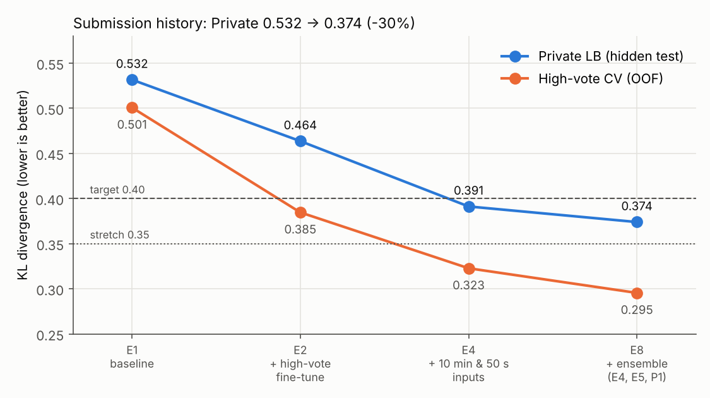

# HMS EEG Profiling : 설명 가능한 뇌파 판독 보조 시스템

> 50초 EEG 구간을 **딥러닝 6개 클래스 확률 + 판독 관점 정량 지표(프로파일)** 로 함께 분석해
> **'소견 + 판정 + 근거 + 신뢰도'** 형태의 판독 보조 리포트를 출력한다.
>
> **결과 요약** : Private KL **0.532 → 0.374 (−30%)** · 편측 AUC 0.945 · 주기성 AUC 0.936 · Seizure 민감도(특이도 0.90) 0.956
>
> ⚠️ 면책 조항 : 본 시스템은 연구 및 학습 목적으로 개발한 EEG 판독 보조 연구용 프로토타입입니다. 의료기기로 허가받거나 임상에서 검증되지 않았으므로, 출력 결과를 실제 환자의 진단·치료·판독에 사용해서는 안 됩니다. 의학적 판단은 반드시 자격을 갖춘 의료 전문가가 내려야 합니다.

## 목차
1. [프로젝트 개요](#1-프로젝트-개요)
2. [주요 기능](#2-주요-기능)
3. [결과 리포트](#3-결과-리포트)
4. [시스템 구조와 평가 설계](#4-시스템-구조와-평가-설계)
5. [실행 방법](#5-실행-방법)
6. [저장소 구조](#6-저장소-구조)
7. [트러블슈팅](#7-트러블슈팅)
8. [한계와 향후 과제](#8-한계와-향후-과제)

---

## 1. 프로젝트 개요

- **문제** : 중환자실 EEG 판독은 전문의 의존도가 높고 판독 지연이 생긴다. 허가된 발작 탐지 제품도 진단 대체가 아닌 **판독 보조**로 쓰인다.
- **목표** : 분류 점수뿐 아니라 **'왜 그 판정인지'를 위치·패턴 단위로 설명**하는 판독 보조 리포트
- **데이터** : [Kaggle HMS - Harmful Brain Activity Classification](https://www.kaggle.com/competitions/hms-harmful-brain-activity-classification)
  - 원시 EEG(200Hz, 19전극 + EKG), 10분 스펙트로그램, 전문가 투표(Seizure·LPD·GPD·LRDA·GRDA·Other)
  - **데이터와 학습 가중치는 저장소에 포함하지 않는다.** 모든 실행은 Kaggle 노트북에서 진행한다.
- **진행 방식** : 가설(H1~H5) 기반 실험, 사전 지정한 판정 기준, 모든 실험을 같은 fold·지표로 비교. 실험 기록은 `experiments/results.csv`(29행)에 남긴다.

| 목표 | 지표 | 기준 | 결과 |
|---|---|---|---|
| 분류 | Private KL | ≤ 0.40 (도전 0.35) | **0.374** 달성 |
| 축 분해 | 편측 대 전반 / 주기성 대 율동성 AUC | 각 ≥ 0.93 | **0.945 / 0.936** 달성 |
| 사업 지표 | Seizure 민감도 @ 특이도 0.90 | ≥ 0.80 | **0.956** 달성 |
| 해석 가능 모델 | 프로파일 지표 모델(P1) 고득표 KL | ≤ 0.50 | **0.486** 달성 |
| 추론 로직 | 근거 일치율 / 플래그 오답률 비 | ≥ 80% / ≥ 2배 | 79.6% / 1.36배 **미달** (사전 규칙, [3-4](#3-4-추론-로직r1--판정-근거-검증)) |

## 2. 주요 기능

| 기능 | 내용 | 위치 |
|---|---|---|
| **신호 품질 판정** | 결측 비율, 평탄 채널 수, 과도 진폭 → 품질 플래그 | `src/quality/signal_qc.py` |
| **판독 관점 프로파일 지표 64개** | 주파수 구성, 편측성, 국소성, 주기성, 율동성, 시간 변화(판정 구간 대 앞뒤 2분), 배경 활동 | `src/profile/qeeg.py` |
| **50초 EEG 스펙트로그램 (GPU)** | 16채널 STFT → 체인별 평균 → 0.5~20Hz 로그 파워 이미지, 학습 파라미터 없는 전처리 층 | `src/models/eeg_spec.py` |
| **입력 방식별 분류기** | 10분 스펙트로그램 / 50초 EEG / 결합 입력을 같은 백본(EfficientNet-B0)으로 전환, 축 보조 헤드 선택 | `src/models/eeg_spec.py`, `nb04_train` |
| **2단계 학습** | 전체 구간 학습 → 고득표(≥10표) 구간 미세조정, 고득표 검증 KL로 최적 epoch 선택 | `nb04_train` |
| **누수 없는 앙상블 선택** | 가중치·온도(T)를 나머지 fold에서만 고르는 중첩 선택, 사전 지정 단순성 규칙 | `nb07_blend` |
| **판정-근거 일관성 검증 (R1)** | 학습 fold 임계값(Youden), 주장별 근거 충족 판정, 축별 재확인 표시 | `src/reasoning/rules.py` |
| **판독 보조 리포트** | [소견]·[판정]·[근거]·[재확인]·[신뢰도]·[플래그], 사례 그림(몽타주 + 스펙트로그램) | `src/reasoning/report.py`, `nb06` |
| **오프라인 제출 파이프라인** | 인터넷 OFF 제출, 학습과 같은 전처리 함수 공유, 학습 데이터 재예측으로 OOF 재현 점검 | `nb08_pack` → `nb05_submit` |

**리포트 출력 예시** (전문가 판정 GPD 85% : 딥러닝은 편측으로 확신했지만 정량 근거가 전반 패턴을 가리켜 재확인 위치를 알려준 사례)
```
[소견] 우측 우세 편측 주기성 방전(LPD), 최대 이상 부위 우측 외측(RL)
[판정] 편측 주기성 방전(LPD) 83% (2순위 전반 주기성 방전(GPD) 11%)
[근거] 편측성 : 좌우 파워 비대칭 0.164 (미충족, 기준 > 0.203), 좌우 델타 비대칭 0.144 (미충족, 기준 > 0.245)
[근거] 주기성 : 정량 근거 미확정 (H5 미지지, 딥러닝 판단만 제시)
[재확인] 편측·전반 판단 재확인
[신뢰도] 중간 (최고 확률 0.83, 근거 불일치 : 편측·전반 판단 재확인)
```

## 3. 결과 리포트

> 상세 : [분석 리포트](reports/analysis_report.md) · [사례 8건 해설](reports/case_reports/commentary.md)

### 3-1. 제출 점수 추이



| 실험 | 내용 | 고득표 CV | Private |
|---|---|---|---|
| E1 | 10분 스펙트로그램 + EfficientNet-B0 (기준선) | 0.501 | 0.532 |
| E2 | + 고득표(≥10표) 2단계 미세조정 | 0.385 | 0.464 |
| E4 | + 10분 스펙트로그램과 50초 EEG 스펙트로그램 결합 | 0.323 | 0.391 |
| **E8** | **0.85·mean(E4, E5) + 0.15·P1v2 (프로파일 지표 모델)** | **0.296** | **0.374** |

- 고득표 CV↔Private 차이는 +0.07~0.08로 일정 → 실험 간 순위·개선폭은 CV로 판단, 절대값은 Private으로 보고
- E8은 후보 48개 중 **사전 지정 규칙**(최저값과 0.005 이내면 단순한 후보 우선)으로 선택

### 3-2. 가설 판정

| 가설 | 판정 기준 (사전 지정) | 결과 | 판정 |
|---|---|---|---|
| H1 고득표 미세조정 | 1단계 대비 고득표 KL ≥ 0.03 개선 | +0.091, Private +0.068, E3~E6에서 재현 | **지지** |
| H2 10분 + 50초 결합 입력 | 단독 입력 최고 대비 ≥ 0.01 개선 | −0.049 (초기·나중 결합 차이 없음) | **지지** |
| H3 좌우 반전 증강 | LPD·LRDA 모두 개선 + 전체 악화 ≤ 0.005 | LPD −0.016, LRDA +0.042, 전체 +0.012 | 미지지 |
| H4 축 분해 멀티태스크 | 편측↔전반 혼동률 모두 감소 + 전체 악화 ≤ 0.005 | 혼동률 변화 없음 (이미 3~5%) | 기각 |
| H5 프로파일 지표 방향성 | 기대 집단 간 Cohen's d ≥ 0.5 | 12개 중 6개 지지 (편측성·율동성·Seizure) | 부분 지지 |

### 3-3. 클래스별 성능


- 해석 가능한 프로파일 모델(P1v2)은 **Seizure에서 가장 좋고** 편측 패턴(LPD·LRDA)에서 가장 약함 → 딥러닝과 상호보완
- 고득표 오답의 **77%는 Other와의 경계**에서 발생 (패턴 간 혼동은 3~5%로 낮음)

### 3-4. 추론 로직(R1) : 판정 근거 검증


- **사전 규칙** : 근거 일치율 79.6%, 불일치 플래그 오답률 비 1.36배 → **목표(80%, 2배) 미달 (공식 결과)**
- **진단** : 근거가 적용되는 축에서는 작동 (편측 2.60배, 율동 2.05배), 시간 변화 근거는 판별력 없음(1.00배), 오답 대부분은 근거 지표가 없는 Other 경계
- **사후 보완 1회 (R1b)** : 편측·율동 근거 또는 저확신 → 80.1%, 2.72배. 단, 저확신 조건만으로 2.96배
- **결론** : 오류 탐지는 딥러닝 확신도가 담당하고, 프로파일 근거의 역할은 **판정 설명과 '어느 판단을 재확인할지' 표시** → 리포트 규칙에 반영

## 4. 시스템 구조와 평가 설계

```
원시 EEG (50초) ─┬─ 1. 신호 품질 판정 ─────────────────────────────┐
                 ├─ 2. 프로파일 지표 64개 ── P1 (LightGBM) ──┐       │
                 └─ 50초 EEG 스펙트로그램 ─┐                  ├─ E8 앙상블 ─ 3. 판정-근거 검증 (R1) ─ 판독 보조 리포트
10분 스펙트로그램 ─────────────────────────┴─ 딥러닝 (E4·E5) ─┘
```

- **대표 구간** : 기록(eeg_id)마다 득표 최다 50초 구간 1개, 총 17,089건. 기록당 구간 수가 클래스별로 크게 달라(LRDA 16.0, Other 2.5) 기록 단위로 학습·평가
- **분할** : patient_id 기준 GroupKFold 5-fold (환자 누수 방지)
- **모델 선택 기준** : 고득표(≥10표, 5,939건) CV KL. 저득표 라벨의 신뢰도가 낮기 때문
- **누수 방지** : 조기 종료, 온도 보정, 앙상블 가중치, 추론 규칙 임계값을 모두 학습 fold 안에서만 결정
- **보고 원칙** : 사전 지정 분석(공식 결과)과 사후 분석(보완·진단)을 구분 (임상시험 분석 관행 적용)

## 5. 실행 방법

모든 단계는 Kaggle 노트북에서 실행한다 (대회 규칙 동의 필요).

| 순서 | 노트북 | 가속기 | 역할 · 출력 |
|---|---|---|---|
| 1 | `nb01_data_check` | CPU | 데이터 구조 확인, EDA |
| 2 | `nb02_preprocess` | CPU | 대표 구간, 몽타주·필터, fold → Dataset `hms-processed` |
| 3 | `nb03_profile_lgbm` | CPU | 프로파일 지표, H5 판정, P1 OOF |
| 4 | `nb04_train` | GPU | E0~E6 학습 (`EXP`, `SMOKE`로 전환) → fold 가중치, OOF |
| 5 | `nb07_blend` | CPU, 인터넷 ON | OOF만으로 앙상블·보정·결합 방식 비교, E8 선택 (수 분) |
| 6 | `nb08_pack` | CPU, 인터넷 ON | 제출용 모델 묶음 (E4·E5 가중치, P1 fold 모델, 레시피) |
| 7 | `nb05_submit` | GPU, **인터넷 OFF** | 제출 (`PRESET` : 단일 실험 / E4E5 / E8) |
| 8 | `nb06_reasoning_report` | CPU | R1 검증·진단, 사례 리포트 8건 |

- `src/`는 이 저장소가 원본이며, Kaggle Dataset `hms-src`로 올려 노트북에서 import한다. 노트북은 Input 경로를 자동 탐색한다.
- 로컬 테스트 : `pip install -r requirements.txt` 후 `pytest tests` (단위 테스트 37건)
- 그림 재생성 : `python reports/make_figures.py`

## 6. 저장소 구조

```
hms-eeg-profiling/
├── README.md
├── requirements.txt              # 로컬 테스트용 (Kaggle 환경에는 기본 설치)
├── configs/base.yaml             # 경로, 시드, fold 수, 필터 대역, 고득표 기준
├── kaggle_notebooks/             # Kaggle 실행 노트북 사본 (nb01~nb08)
├── kaggle/dataset-metadata.json  # src/ → Kaggle Dataset 'hms-src' 업로드용
├── src/
│   ├── config.py                 # 설정 로드
│   ├── data/
│   │   ├── load.py               # Kaggle 경로 자동 탐색, 50초 EEG·10분 스펙트로그램 절단
│   │   ├── filters.py            # 결측 보간, 0.5~20Hz 대역 통과 필터
│   │   ├── targets.py            # 투표→확률, 축 보조 정답, 마스크, Seizure 이진 정답, 대표 구간 선택
│   │   ├── montage.py            # 더블 바나나 16채널, 좌우 반전 (EEG·스펙트로그램)
│   │   ├── folds.py              # patient_id 기준 GroupKFold, 누수 검사
│   │   └── build.py              # hms-processed 생성, eeg_segment (학습·제출 공통 EEG 전처리)
│   ├── quality/signal_qc.py      # 1단계 신호 품질 지표
│   ├── profile/qeeg.py           # 2단계 프로파일 지표 64개
│   ├── models/eeg_spec.py        # 50초 EEG 스펙트로그램(GPU STFT), 입력 방식별 분류기 HMSNet
│   ├── reasoning/
│   │   ├── rules.py              # R1 : 근거 지표, 학습 fold 임계값, 판정-근거 일치 판정
│   │   └── report.py             # 판독 보조 리포트 문구
│   └── eval/metrics.py           # KL(전체/고득표), 축별 AUC, 민감도@특이도
├── tests/                        # 단위 테스트 37건 (합성 신호로 지표 방향성 검증 포함)
├── experiments/results.csv       # 실험 결과표 (29행)
└── reports/
    ├── analysis_report.md        # 분석 리포트
    ├── make_figures.py           # 결과 그림 생성
    ├── figures/                  # 결과 그림 3종
    └── case_reports/             # 사례 리포트 해설 (+ nb06 출력 그림)
```

## 7. 트러블슈팅

Kaggle 노트북 전용 환경(데이터 미다운로드, 주간 GPU 할당, 인터넷 OFF 제출)에서 겪은 문제와 해결 방법이다.

### 7-1. 실행 환경

| 증상 | 원인 | 해결 |
|---|---|---|
| 데이터 경로를 찾지 못함 (`DATA_DIR` False) | 대회 데이터가 `/kaggle/input/competitions/...`, 개인 Dataset이 `/kaggle/input/datasets/<계정>/...` 아래에 마운트됨 | 모든 노트북이 표식 파일(`train.csv`, `eeg50.npy`, `src/...`)로 **Input 경로를 자동 탐색** |
| 학습 1 epoch에 155초 | ① GPU가 꺼진 상태(CPU 학습) ② Dataset 디스크에서 표본마다 무작위 읽기 | ① 셀 0에서 장치 확인·경고 ② 배열을 **메모리에 한 번에 적재** → T4에서 19~20초 |
| Save Version 중 진행 로그를 볼 수 없고, 진단용 셀 오류로 버전 저장 실패 | 배치 실행은 실행 중 로그 비공개, 셀 하나의 오류로 전체 실패 | 진단 셀에 `[진단·실행 후 삭제]` 표시, 새 실험은 **`SMOKE=True`로 대화형 점검**(약 3분) 후 저장 |
| `ConcurrencyViolation` 저장 오류 | 같은 노트북을 여러 탭·세션에서 열어 저장본 순번 충돌 | **한 노트북은 한 탭에서만 편집**, 새로고침 후 다시 저장 |
| GPU 할당량이 예상보다 빨리 줄어듦 | 대화형 GPU 세션은 유휴 상태에서도 할당량 사용 | Save Version 시작 직후 **세션 종료**를 체크리스트에 포함 |
| 같은 노트북(nb03)의 실행 시간이 134초 ~ 2.2시간으로 변동 | Kaggle CPU 세션별 성능 차이 | 지표는 한 번 산출해 CSV로 저장, 이후 분석(nb07·nb08)은 **CSV·OOF만 읽는 경량 노트북**으로 분리 |

### 7-2. 코드·데이터 연결

| 증상 | 원인 | 해결 |
|---|---|---|
| 새 함수 인자 `TypeError` (`check_claims() got an unexpected keyword argument`) | 노트북 Input의 `hms-src`가 이전 Dataset 버전에 고정됨 | Input 버전을 최신으로 변경 후 세션 재시작. 노트북은 **함수 서명을 검사**해 이전 버전이면 안내 메시지 또는 동일 동작 함수로 대체 |
| 이전 실험 버전의 Output을 함께 쓸 수 없음 | 같은 노트북의 여러 버전을 동시에 Input으로 연결하기 어려움 | `kagglehub.notebook_output_download("<계정>/<노트북>/versions/N")`로 버전별 OOF 수집 |
| kagglehub 호출 후 노트북이 3시간 이상 멈춤 | Kaggle 안의 kagglehub 기본 동작은 'Input으로 연결 후 마운트될 때까지 무한 대기'이며, 배치 실행에서는 끝나지 않음 | `DISABLE_KAGGLE_CACHE=1`로 HTTP 직접 다운로드 + **버전당 시간 제한(SIGALRM)** + 인터넷 사전 확인 |
| kagglehub 다운로드가 일부 실험만 실패 | 버전을 하나씩 탐색하며 요청이 누적되어 요청 횟수 제한 가능성 | 확인된 버전 먼저 요청, 429 응답 시 재시도, 실패 원인 출력. 가장 확실한 방법은 **Output을 Input으로 직접 연결** |
| 제출 노트북에서 fold 가중치가 10개로 잡힘 | 2단계 학습이 `fold{k}_stage1.pt`도 저장해 `fold*.pt` 패턴에 함께 걸림 | 패턴을 `fold[0-9].pt`로 한정 |

### 7-3. 제출

| 증상 | 원인 | 해결 |
|---|---|---|
| Submit 시 `Cannot submit : Notebook cannot use internet access` | 코드 대회는 인터넷 OFF로 저장한 버전만 제출 가능 | Settings → Internet Off 후 **새 버전**을 저장해 그 버전으로 제출. 셀 0에서 인터넷이 켜져 있으면 경고 출력 |
| 여러 실험 버전의 가중치를 인터넷 없이 불러와야 함 | 제출 노트북은 인터넷 OFF라 kagglehub 사용 불가 | 인터넷이 되는 `nb08_pack`에서 E4·E5 가중치와 P1 모델을 **한 Output으로 묶어** 제출 노트북 Input에 연결 |
| 학습·추론 전처리 불일치 위험 | 학습(nb02)과 제출(nb05)이 서로 다른 코드로 전처리하면 성능이 조용히 떨어짐 | 공통 함수(`eeg_segment`, 스펙트로그램 변환)를 src에서 공유하고, **학습 데이터 32건을 같은 추론 경로로 다시 예측해 OOF와 비교**(최대 차이 0.02 미만이면 통과, 실측 0.001) |

### 7-4. 분석 설계

| 증상 | 원인 | 해결 |
|---|---|---|
| 좌우 반전 왕복 점검 `AssertionError` | 표본별 표준화의 float32 합산 순서 차이(약 2e-7)를 기본 `allclose` 기준이 허용하지 않음 | 최대 차이를 출력하고 1e-3 미만이면 통과 (블록 배치 오류면 차이가 1 수준) |
| 앙상블 이득이 '보정 효과'인지 '정보 효과'인지 불분명 | 0.5:0.5 평균 자체가 과신한 확률을 완화함 | temperature scaling 대조군으로 이득을 분해 (보정 몫 32%, 상호보완 68%) |
| OOF로 고른 앙상블 가중치·후보가 낙관적 | 선택에 쓴 데이터로 성능을 평가 | 가중치·T는 **나머지 fold에서만 선택**(중첩), 후보 선택은 사전 지정 단순성 규칙 |
| 효과크기(Cohen's d)가 평균 차이 6배인 지표에서 0.03 | 분포 꼬리가 두꺼워 표준편차가 커짐 | 사후에 척도를 바꾸지 않고 판정 그대로 보고, 추론 근거에서 제외 (모델 입력으로만 사용) |
| 추론 규칙이 목표 미달 | 오답 대부분이 근거 지표가 없는 Other 경계, 근거와 딥러닝의 오류가 겹침 | 오답 분해·축별 실효성·확률 대조군으로 진단 → 사후 보완 1회, 보완 결과가 목표를 넘긴 요인(확신도)까지 함께 보고 |

## 8. 한계와 향후 과제

- **한계**
  - HMS는 연속 기록이 아닌 구간 단위 데이터라 시간당 오경보율을 산출할 수 없어 특이도로 대체
  - 투표 수 편차(1~28표)로 저득표 라벨의 신뢰도가 낮음
  - 검증 fold로 epoch를 골라 CV가 Private보다 0.07~0.08 낙관적
  - 주기성 근거 미확정, Other(배경·국소 서파) 판별 지표 없음
  - 사례 그림 해석은 비전문가 관찰이며 임상 전문가 검토를 받지 않음
- **향후 과제**
  - Other 경계 지표 (배경 연속성, 다형성 대 단형성), 주기성 지표 재설계
  - 전문가 간 불일치(투표 분포 불확실성)를 직접 예측해 확신도 신호 강화
  - 측두 4채널 축소 모델(H6)로 경량 기기 적용성 평가
