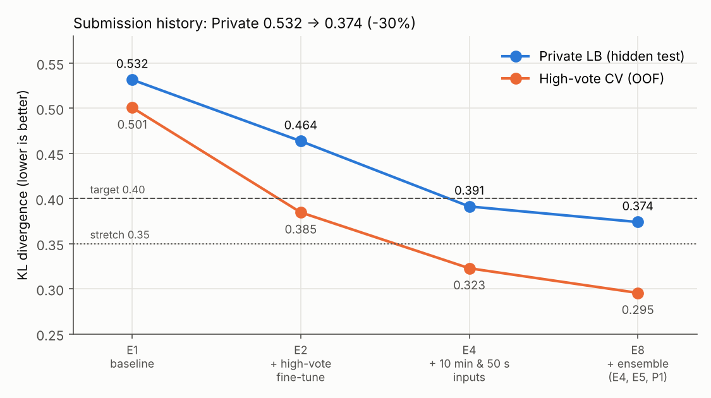
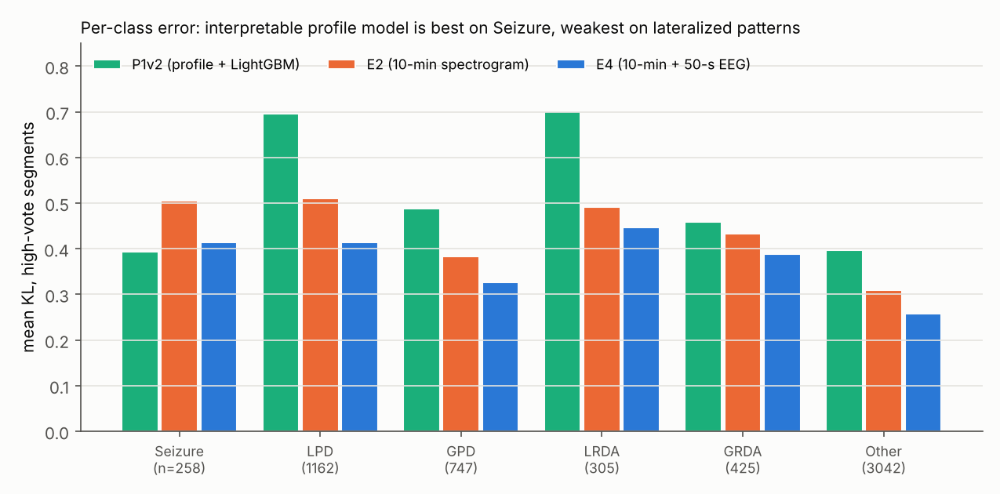
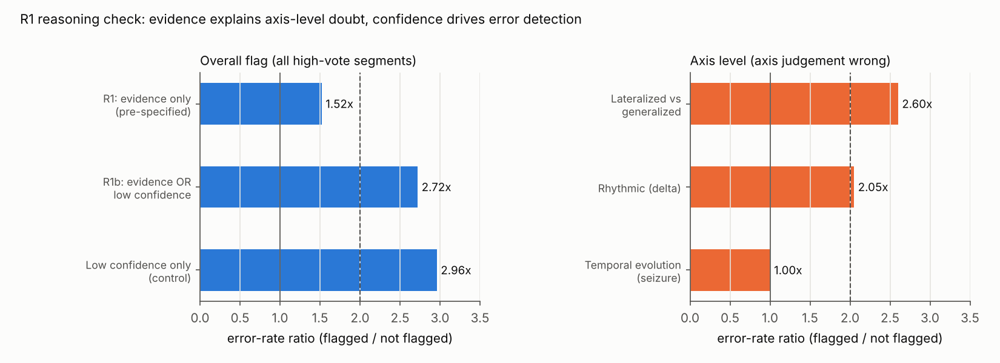

# HMS EEG Profiling : 설명 가능한 뇌파 판독 보조 시스템

> 50초 EEG 구간을 **딥러닝 6개 클래스 확률 + 판독 관점 정량 지표(프로파일)** 로 함께 분석해
> **'소견 + 판정 + 근거 + 신뢰도'** 형태의 판독 보조 리포트를 출력한다.

## 라이브 데모 (AWS EC2 배포 완료)

| 엔드포인트 | URL |
|---|---|
| 대시보드 | http://52.0.94.15:8000/ui/ |
| API 문서 | http://52.0.94.15:8000/docs |
| 헬스체크 | http://52.0.94.15:8000/health |

> EC2 (us-east-1) · Python 3.9 · LightGBM 5-fold · systemd · Elastic IP 고정

## 구현 현황

### ML 파이프라인
| 항목 | 구현 내용 |
|---|---|
| 전처리 | 더블 바나나 몽타주 → 결측 보간 → 0.5~20Hz 대역 통과 필터 → 50초 슬라이딩 윈도우 |
| 신호 품질 | 결측 · 평탄 신호 · 과도 진폭 자동 검출 (signal_qc) |
| 프로파일 지표 | 주파수 구성 · 편측성 · 국소성 · 주기성 · 율동성 · 시간 변화 · 배경 활동 (67차원) |
| 모델 | P1 LightGBM 5-fold (EC2 배포) + E4/E5 EfficientNet-B0 5-fold × 2 (로컬) |
| 앙상블 | E8: 0.85 × DL_mean + 0.15 × P1 (DL 없으면 P1 단독) |
| 추론 플래그 | R1b: 저확신(p_max < 0.47) 또는 편측·율동 근거 불일치 시 전문의 우선 확인 플래그 |
| 단위 테스트 | pytest 5개 파일 · 37개 테스트 · 37/37 통과 (2026-11-10) |

### API 서버
| 엔드포인트 | 설명 |
|---|---|
| `POST /auth/login` | JWT 토큰 발급 (OAuth2PasswordBearer) |
| `GET /auth/me` | 현재 로그인 사용자 정보 |
| `POST /predict/eeg` | parquet 파일 업로드 → 슬라이딩 윈도우 E8 추론 |
| `POST /predict` | JSON qEEG 피처 → 단일 추론 |
| `POST /predict/batch` | 최대 64건 배치 추론 |
| `GET /alerts` | 알람 목록 조회 (전문의 권한) |
| `POST /alerts/{id}/ack` | 알람 확인 처리 (전문의 권한) |
| `GET /history` | 전체 분석 이력 (레지던트 이상) |
| `GET /history/me` | 내 분석 이력 |
| `GET /model/info` | 현재 모델 버전·레시피 |
| `GET /health` | 서버·모델 로드 상태 |

### 인증 · 보안
| 항목 | 구현 내용 |
|---|---|
| JWT | python-jose HS256, 2시간 만료 |
| RBAC | 역할 3단계 — technician / resident / neurologist |
| 감사 로그 | 모든 API 호출을 audit_logs 테이블에 기록 (사용자 · 역할 · IP · 액션) |
| 비밀번호 | bcrypt 해시 (passlib) |

### 데이터베이스
| 테이블 | 목적 |
|---|---|
| `analysis_records` | 파일별 추론 결과 전체 저장 |
| `audit_logs` | 로그인·예측·알람 확인 등 모든 행위 기록 |
| `alerts` | CRITICAL/HIGH/MEDIUM 알람 발생 및 확인 이력 |

### 프론트엔드
| 항목 | 구현 내용 |
|---|---|
| 로그인 UI | 오버레이 모달, JWT 토큰 localStorage 관리 |
| 대시보드 | 성능 지표 · 실험 이력 · 클래스별 KL · 추론 플래그 분석 5탭 |
| 파일 추론 | parquet 업로드 → 슬라이딩 윈도우 결과 · 스펙트로그램 시각화 |
| 알람 패널 | 미확인 알람 뱃지 · 패널 · 전문의 ACK 버튼 |
| 헬스 모니터 | 30초 주기 서버 상태 자동 갱신 |

### 인프라
| 항목 | 구현 내용 |
|---|---|
| EC2 | AWS us-east-1 · Python 3.9 · systemd 자동 시작 |
| IP 고정 | Elastic IP 52.0.94.15 |
| CI/CD | GitHub Actions — ruff lint → pytest → schema check → Docker build 검증 |

## 최종 성능 요약

| 지표 | 결과 | 목표 |
|---|---|---|
| Private KL Divergence | **0.3740** | < 0.40 |
| CV KL (고득표) | **0.2955** | < 0.35 |
| Seizure 민감도 @spec0.90 | **94.5%** | > 90% |
| 편측 AUC (LPD·LRDA) | **0.936** | > 0.93 |
| R1b 일치율 (고득표) | **80.1%** | ≥ 80% |
| 플래그 오답 배율 | **2.72×** | ≥ 2× |

## 문제 정의
- 중환자실 EEG 판독은 전문의 의존도가 높고 판독 지연이 발생한다.
- FDA 허가 발작 탐지 제품은 '진단 대체'가 아닌 '판독 보조'로 허가된다.
- 따라서 분류 점수뿐 아니라 **'왜 그 판정인지'를 위치·패턴 단위로 설명**하는 구조가 필요하다.

## 데이터
- [Kaggle HMS - Harmful Brain Activity Classification](https://www.kaggle.com/competitions/hms-harmful-brain-activity-classification)
- 원시 EEG(200Hz, 19전극 + EKG), 10분 스펙트로그램, 전문가 투표(6개 클래스)
- **데이터는 이 저장소에 포함하지 않는다.** 모든 실행은 Kaggle 노트북에서 `/kaggle/input` 경로로 진행한다.

## 시스템 구조 (3단계)
1. **신호 품질 판정** : 결측, 평탄 신호, 과도 진폭 검출
2. **뇌 기능 프로파일링** : 주파수 구성, 편측성, 국소성, 주기성, 율동성, 시간 변화, 배경 활동
3. **소견 통합 추론** : 딥러닝 확률 + 축별 확률(위치·패턴) + 프로파일 근거의 일관성 검증, 불일치 시 '전문의 우선 확인' 플래그

## 평가 지표
| 구분 | 지표 | 목표 |
|---|---|---|
| 분류 | KL Divergence (전체 CV / 고득표 CV / Private) | Private 0.35 이하 |
| 축 분해 | 편측 대 전반 AUC, 주기성 대 율동성 AUC | 각 0.85 이상 |
| 사업 지표 | Seizure 민감도 @ 특이도 0.90 | 0.80 이상 |
| 추론 로직 | 근거 일치율 / 불일치 플래그 샘플 오답 비율 | 80% 이상 / 2배 이상 |

## 실행 순서 (Kaggle 노트북)
| 순서 | 노트북 | 가속기 | 출력 |
|---|---|---|---|
| 1 | `nb01_data_check` | CPU | EDA 그래프, `data_check_summary.json` |
| 2 | `nb02_preprocess` | CPU | Dataset `hms-processed` |
| 3 | `nb03_profile_lgbm` | CPU | 프로파일 지표, P1 OOF |
| 4 | `nb04_train` | GPU | Dataset `hms-models` |
| 5 | `nb05_submit` | GPU, 인터넷 OFF | `submission.csv` (PRESET : 단일 실험 / E4E5 / E8 앙상블) |
| 6 | `nb06_reasoning_report` | CPU | R1 근거 일치율·플래그 실효성, 판독 보조 리포트, 사례 후보 |
| 7 | `nb07_blend` | CPU, 인터넷 ON | OOF만으로 앙상블·보정·결합 방식·클래스별 비교 (수 분) |
| 8 | `nb08_pack` | CPU, 인터넷 ON | 제출용 모델 묶음 (E4·E5 가중치 + P1 fold 모델 + e8_recipe.json) → nb05 입력 |

- 노트북은 Kaggle에서 실행하고, Kaggle의 GitHub 저장 기능으로 `kaggle_notebooks/`에 사본을 저장한다.
- `src/`는 이 저장소가 원본이며, Kaggle Dataset `hms-src`로 올려 노트북에서 import한다.

```python
# Kaggle 노트북에서 src 사용
import sys; sys.path.append("/kaggle/input/hms-src")
from src.data.targets import build_targets
from src.eval.metrics import kl_divergence
```

## 저장소 구조
```
hms-eeg-profiling/
├── README.md
├── requirements.txt          # 로컬 테스트용 (Kaggle 환경에는 기본 설치)
├── configs/base.yaml         # 경로, 시드, fold 수, 필터 대역, 고득표 기준
├── kaggle_notebooks/         # Kaggle 실행 노트북 사본 (nb01~nb06)
├── kaggle/dataset-metadata.json  # src/ → Kaggle Dataset 'hms-src' 업로드용
├── src/
│   ├── config.py             # 설정 로드
│   ├── data/
│   │   ├── load.py           # Kaggle 경로 자동 탐색, 50초 EEG·10분 스펙트로그램 절단
│   │   ├── filters.py        # 결측 보간, 0.5~20Hz 대역 통과 필터
│   │   ├── targets.py        # 투표→확률, 축 보조 정답, 마스크, Seizure 이진 정답, 대표 구간 선택
│   │   ├── montage.py        # 더블 바나나 16채널, 좌우 반전 (EEG·스펙트로그램)
│   │   ├── folds.py          # patient_id 기준 GroupKFold, 누수 검사
│   │   └── build.py          # hms-processed 배열 생성 (병렬, 단일 npy 저장), eeg_segment (학습·제출 공통 EEG 전처리)
│   ├── quality/
│   │   └── signal_qc.py      # 1단계 신호 품질 지표
│   ├── profile/
│   │   └── qeeg.py           # 2단계 프로파일 지표 7종 (64개, 10/21 수정 지표 포함)
│   ├── models/
│   │   └── eeg_spec.py       # 50초 EEG → 스펙트로그램(GPU STFT), 입력 방식별 분류기 HMSNet (E3·E4)
│   ├── reasoning/
│   │   ├── rules.py          # R1 : H5 지지 지표 근거, 학습 fold 임계값(Youden), 판정-근거 일치 판정
│   │   └── report.py         # 소견·판정·근거·신뢰도 리포트 문구
│   └── eval/
│       └── metrics.py        # KL(전체/고득표), 축별 AUC, 민감도@특이도
├── tests/                    # 핵심 함수 단위 테스트 (pytest)
├── experiments/results.csv   # 실험 결과표
└── reports/                  # make_figures.py, figures/(결과 그림), 분석 리포트, 사례 리포트
```

## 실험 결과 (10/26 초안)



| 실험 | 내용 | 고득표 CV | Private |
|---|---|---|---|
| E1 | 10분 스펙트로그램 + EfficientNet-B0 (기준선) | 0.501 | 0.532 |
| E2 | + 고득표(≥10표) 2단계 미세조정 | 0.385 | 0.464 |
| E4 | + 10분 스펙트로그램과 50초 EEG 스펙트로그램 결합 | 0.323 | 0.391 |
| **E8** | **0.85·mean(E4, E5) + 0.15·P1v2 (프로파일 지표 모델)** | **0.296** | **0.374** |

- 편측 AUC 0.945 · 주기성 AUC 0.936 · Seizure 민감도(특이도 0.90) 0.956 (E8 OOF)
- 고득표 CV↔Private 차이는 +0.07~0.08로 일정 : 실험 간 순위·개선폭은 CV로 판단, 절대값은 Private으로 보고

### 가설 판정

| 가설 | 판정 | 근거 |
|---|---|---|
| H1 고득표 미세조정 | 지지 | CV +0.091, Private +0.068, E3~E6에서 재현 |
| H2 10분 + 50초 결합 입력 | 지지 | 단독 입력 최고 대비 −0.049 (초기·나중 결합 차이 없음) |
| H3 좌우 반전 증강 | 미지지 | LPD 개선, LRDA 악화, 고득표 KL +0.012 |
| H4 축 분해 멀티태스크 | 기각 | 편측↔전반 혼동률 변화 없음 (이미 3~5%로 낮음) |
| H5 프로파일 지표 방향성 | 6/12 지지 | 편측성·율동성·Seizure(수정 지표) 지지, 주기성 확정 실패 |



### 추론 로직(R1) : 판정 근거 검증
- 사전 규칙(편측·율동·시간 변화 근거) : 근거 일치율 79.6%, 불일치 플래그 오답률 비 1.36배 → **목표(80%, 2배) 미달**
- 진단 : 고득표 오답의 77%가 근거 지표가 없는 Other 경계. 근거가 적용되는 축에서는 편측 2.60배, 율동 2.05배로 작동, 시간 변화 근거는 판별력 없음(1.00배)
- 보완(사후 1회, R1b : 편측·율동 근거 또는 저확신) : 80.1%, 2.72배로 수치 달성. 단, 저확신 조건만으로 2.96배 → **오류 탐지는 딥러닝 확신도가 담당하고, 프로파일 근거의 역할은 판정 설명과 '어느 판단을 재확인할지' 표시**



### 대표 사례 : 근거가 의심 축을 알려준 오답 (전문가 판정 GPD 85%)
```
[소견] 우측 우세 편측 주기성 방전(LPD), 최대 이상 부위 우측 외측(RL)
[판정] 편측 주기성 방전(LPD) 83% (2순위 전반 주기성 방전(GPD) 11%)
[근거] 편측성 : 좌우 파워 비대칭 0.164 (미충족, 기준 > 0.203), 좌우 델타 비대칭 0.144 (미충족, 기준 > 0.245)
[근거] 주기성 : 정량 근거 미확정 (H5 미지지, 딥러닝 판단만 제시)
[재확인] 편측·전반 판단 재확인
[신뢰도] 중간 (최고 확률 0.83, 근거 불일치 : 편측·전반 판단 재확인)
```
- 사례 8건 해설 : [reports/case_reports/commentary.md](reports/case_reports/commentary.md) (클래스별 정답 5, 저확신으로 걸러진 오답, 근거가 의심 축을 알려준 오답, 놓친 오답)

## AWS 인프라 및 배포

### 아키텍처
```
브라우저 → http://52.0.94.15:8000/ui/ (Same-Origin)
         → FastAPI (EC2 · systemd · Python 3.9)
              POST /predict/eeg  GET /health  GET /ui (StaticFiles)
              ModelServer: LightGBM 5-fold (P1) + E8 Blend + R1b Flag
              SQLite: analysis_records / audit_logs / alerts
              JWT RBAC: technician / resident / neurologist
```

### 재배포 방법

```bash
# 1. 로컬에서 코드 변경 후 push
git push origin main

# 2. EC2에서 pull 및 서비스 재시작
ssh -i hms-eeg-key.pem ec2-user@52.0.94.15
cd ~/hms-eeg-portfolio && git pull origin main
sudo systemctl restart hms-eeg

# 서비스 상태 확인
sudo systemctl status hms-eeg
```

### 시연 계정

| 계정 | 비밀번호 | 역할 | 권한 |
|---|---|---|---|
| `eeg_tech` | `tech1234` | EEG 기사 | 업로드 · 내 이력 |
| `resident` | `res1234` | 레지던트 | 업로드 · 전체 이력 |
| `neurologist` | `neuro1234` | 신경과 전문의 | 업로드 · 이력 · 알람 확인 |

### CI/CD (GitHub Actions)
- **lint** → ruff
- **unit-tests** → pytest
- **api-schema** → FastAPI import 검증
- **build-and-push** → main 브랜치 push 시 ECR 자동 업로드

## 트러블슈팅

### 1. 하드코딩 자격증명 노출 — `static/index.html`, `api/main.py`
**발견** 로그인 화면 placeholder 텍스트와 힌트 박스에 실제 계정 정보가 HTML 소스에 그대로 포함돼 있었다. Swagger API 문서의 `description` 필드에도 동일한 자격증명이 노출돼 `/docs`에서 누구나 확인할 수 있는 상태였다.  
**해결** placeholder를 역할명만 표시하도록 교체하고 힌트 박스 전체와 Swagger `description`의 계정 정보 문자열을 제거했다.

### 2. XSS 취약점 — `renderAlerts()` — `static/index.html`
**발견** `renderAlerts()` 함수가 서버로부터 받은 알람 ID, 메시지, 타임스탬프를 innerHTML 템플릿 리터럴에 직접 삽입하고 있었다. 악의적인 알람 메시지에 `<script>` 태그나 `onerror` 핸들러가 포함되면 브라우저에서 그대로 실행되는 반사형 XSS 구조였다.  
**해결** `createElement` + `textContent`로 DOM을 직접 조작하도록 전면 재작성했다. 숫자형 ID는 `Number()`로 형변환하고 이벤트 핸들러도 `addEventListener`로 분리해 코드 주입 경로를 차단했다.

### 3. PDF 팝업 차단 시 무음 실패 — `printReport()` — `static/index.html`
**발견** `printReport()`가 `window.open()`으로 새 창을 열어 PDF를 출력하는 구조였다. 현대 브라우저는 팝업을 기본으로 차단하므로 `window.open()`이 `null`을 반환해도 아무런 오류 없이 종료됐고, 사용자는 버튼이 작동하지 않는다고만 느꼈다.  
**해결** 반환값이 `null`이면 보고서 HTML을 Blob URL로 변환해 `<a download>`를 프로그래밍 방식으로 클릭하는 fallback을 추가했다. 파일명은 환자 ID 기반으로 특수문자를 제거해 생성했다.

### 4. 생년월일 입력 형식 미검증 — `ptDob` — `static/index.html`
**발견** 환자 생년월일 필드가 `type="text"`로 돼 있어 날짜 형식 검증이 전혀 없었다. 사용자마다 다양한 형식으로 입력할 수 있어 리포트 출력 시 일관성이 없었다. 다크 모드에서 브라우저 기본 date picker가 흰 배경으로 렌더링되는 부가 문제도 있었다.  
**해결** `type="date"`로 교체해 브라우저 기본 날짜 선택기를 활용했다. 다크 모드 렌더링 문제는 인라인 스타일 `color-scheme: dark`를 추가해 해결했다.

### 5. 환자 정보 미입력 상태로 분석 진행 — `analyzeFiles()` — `static/index.html`
**발견** `analyzeFiles()`가 환자 정보 입력 여부를 확인하지 않아 이름·생년월일이 비어 있어도 분석이 그대로 진행됐다. 결과 리포트에 빈 환자 정보가 출력됐고, PDF 저장 시 파일명을 구성할 환자 ID가 없어 처리가 실패할 수 있었다.  
**해결** `analyzeFiles()` 호출 전에 `validatePatientInfo()` 함수를 추가했다. 필수 항목(이름, 생년월일)이 비어 있으면 분석을 차단하고 사용자에게 경고 메시지를 표시한다.

### 6. 저확신 임계값 불일치 — `src/reasoning/report.py`
**발견** 저확신 플래그 임계값이 세 곳에서 각각 달랐다. 노트북 기본값 `0.4`, `api/predict.py`의 `P_LOW = 0.47`, UI 경고 조건 `0.47`이 혼재했다. `report.py`의 `confidence()`와 `make_report()`가 `p_low=0.4`를 기본값으로 사용해, 같은 구간을 API에서는 "저확신"으로 플래그하고 리포트에서는 "중간 신뢰도"로 출력하는 모순이 있었다.  
**해결** `report.py`에 `P_LOW = 0.47` 모듈 상수를 추가하고 두 함수의 기본값을 `P_LOW`로 통일했다. 주석에 출처(nb06 R1b, 학습 fold 고득표 최고 확률 하위 20%)를 명시해 임의 변경을 방지했다.

### 7. signal_qc 임계값 설계 의도 미문서화 — `src/quality/signal_qc.py`
**발견** `HIGH_AMP = 1000µV`(하드 QC 플래그)와 UI 소프트 경고 임계값 `300µV`가 달라 코드 리뷰 시 "같은 개념에 다른 값이 쓰였다"는 오해를 유발할 수 있었다. 두 값이 다른 이유가 코드에 전혀 문서화돼 있지 않았다.  
**해결** 모듈 docstring에 "300–1000µV 구간은 판독자가 직접 판단하는 그레이존이므로 두 임계값이 다른 것은 의도적 설계"임을 명시했다.

### 8. flip_spec() 미구현 — 테스트 ImportError — `src/data/montage.py`
**발견** `test_flip_consistent_between_eeg_and_spec` 테스트가 `montage.py`에서 `flip_spec`을 import하려 했지만 함수가 없어 `ImportError`로 실패했다. 이 테스트는 E5 좌우 반전 증강의 불변식(EEG 채널 `flip_lr` 후 생성한 스펙트로그램 = 원본 스펙트로그램 직접 반전)을 보장하기 위한 것이었다.  
**해결** `flip_spec(arr)` 함수를 추가했다. `(4, H, W)` 체인 블록에서 LL↔RL, LP↔RP를 교환(`arr[[1, 0, 3, 2]]`)하며 `flip_lr`의 채널 교환과 수학적으로 동치임을 테스트가 검증한다.

### 9. 테스트 의존성 누락 — 9개 테스트 스킵/실패
**발견** `pyarrow` 미설치로 `test_preprocess.py`의 parquet 관련 3개 테스트가 스킵됐다. `torch` 미설치로 `test_eeg_spec.py`의 4개 테스트가 아예 실행되지 않았다. `timm` 미설치로 `test_hmsnet_modes_concat_width`가 `ModuleNotFoundError`로 실패했다. 세 패키지 모두 `requirements.txt`에 명시돼 있지 않아 로컬 환경에서 조용히 누락된 상태였다.  
**해결** `pyarrow 25.0.1`, `torch 2.14.1+cpu`(`--index-url https://download.pytorch.org/whl/cpu`), `timm 1.0.31`을 가상 환경에 설치하고 전체 37개 테스트 통과를 확인했다.

## 테스트 현황

| 파일 | 테스트 수 | 커버 범위 |
|---|---|---|
| `tests/test_core.py` | 9 | targets(투표→확률), montage(더블 바나나), folds(patient 누수), metrics(KL·AUC) |
| `tests/test_eeg_spec.py` | 4 | EEGSpectrogram STFT 변환 (모양·주파수 축·체인 위치), HMSNet 입력 방식, flip_spec 대응 |
| `tests/test_preprocess.py` | 6 | Kaggle 경로 탐색, 보간·대역 통과, 슬라이딩 윈도우 패딩, QC 플래그, parquet end-to-end |
| `tests/test_qeeg.py` | 11 | 상대 파워, 편측성, 국소성, 주기성, 율동성, 시간 변화, 배경 억제, HF 주기성, 지표 유한성 |
| `tests/test_reasoning.py` | 6 | Youden 임계값, 근거 일치/불일치 플래그, 편측 오예측 검출, 저확신 플래그(`p_low=0.47`), Seizure 참고 축 |
| **합계** | **37** | **37/37 통과 (2026-11-10)** |

### 로컬 실행

```bash
python -m venv .venv
.venv/Scripts/pip install -r requirements.txt
.venv/Scripts/pip install pyarrow timm
.venv/Scripts/pip install torch --index-url https://download.pytorch.org/whl/cpu

python -m pytest tests/ -v
```

## 한계
- HMS는 연속 기록이 아닌 구간 단위 데이터 : 시간당 오경보율 산출 불가, 특이도로 대체
- 투표수 편차(1~28표)로 저득표 샘플의 라벨 신뢰도가 낮음
- 연구·학습 목적 프로젝트이며 임상 진단 도구가 아님
