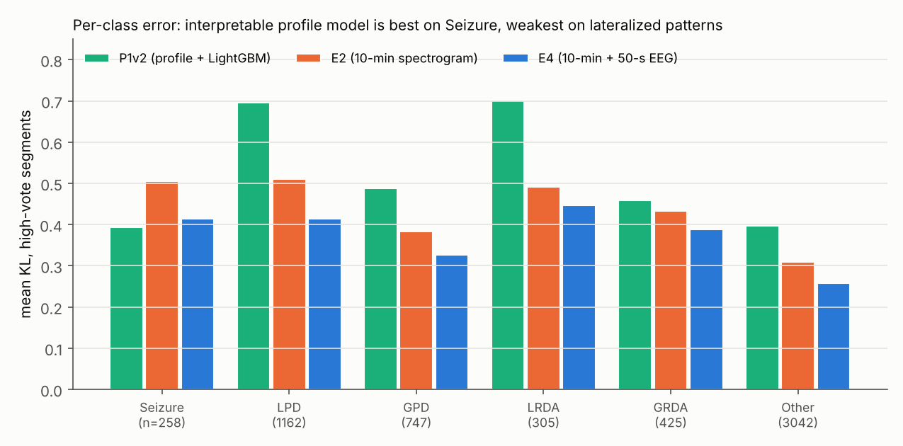
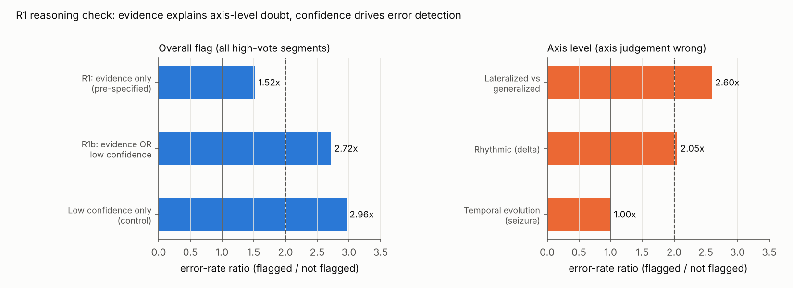

# HMS EEG 판독 보조 시스템 : 분석 리포트

> Kaggle HMS - Harmful Brain Activity Classification 데이터로 만든 연구·학습 목적 포트폴리오입니다. 임상 진단 도구가 아닙니다.
> 작성 2026-10-26 (초안) · 결과표 `experiments/results.csv` · 실험 기록 Notion 「코드북_수정」 1~22차 수정

## 1. 요약

- **분류 성능** : 기준선 Private KL **0.532 → 최종 0.374 (−30%)**. 분류 목표(0.40 이하)를 달성했고, 도전 목표(0.35)까지는 0.024가 남았습니다.
- **효과가 확인된 설계 2가지** : 고득표(≥10표) 구간 2단계 미세조정(H1), 10분 스펙트로그램과 50초 EEG 스펙트로그램의 결합(H2)
- **효과가 없던 설계 2가지** : 좌우 반전 증강(H3), 편측·주기성 보조 헤드(H4). 둘 다 전체 KL은 개선했지만, 모델 선택 기준인 고득표 KL은 악화되었습니다.
- **해석 가능한 지표** : 판독 관점 지표 64개 중 6개가 도메인 지식과 같은 방향의 효과크기 기준(d ≥ 0.5)을 통과했습니다(H5). 이 지표만으로 만든 모델(P1v2)은 고득표 KL 0.486이며, 앙상블에 가중치 0.15로 기여합니다.
- **추론 로직(R1)** : 사전 규칙으로는 목표(근거 일치율 80%, 플래그 오답률 2배)에 **미달**했습니다. 진단 결과, **오류 탐지는 딥러닝 확신도가 담당하고 프로파일 근거의 역할은 판정 설명과 "어느 판단을 재확인할지" 표시**라는 결론을 얻었습니다.

## 2. 문제 정의와 목표

- 중환자실 EEG 판독은 전문의 의존도가 높고 판독 지연이 생깁니다. 허가된 발작 탐지 제품도 진단 대체가 아닌 **판독 보조**로 쓰입니다.
- 따라서 6개 클래스(Seizure·LPD·GPD·LRDA·GRDA·Other) 확률과 함께 **"왜 그 판정인지"를 위치·패턴 단위로 설명하는 리포트**를 목표로 했습니다.
- **출력 형식** : [소견] · [판정] · [근거] · [재확인] · [신뢰도] · [플래그]

| 구분 | 지표 | 목표 | 결과 (E8) |
|---|---|---|---|
| 분류 | Private KL | ≤ 0.40 (도전 0.35) | **0.374** |
| 축 분해 | 편측 대 전반 AUC / 주기성 대 율동성 AUC | 각 ≥ 0.93 | **0.945 / 0.936** |
| 사업 지표 | Seizure 민감도 @ 특이도 0.90 | ≥ 0.80 | **0.956** |
| 프로파일 모델 | P1 단독 고득표 KL | ≤ 0.50 | **0.486** |
| 추론 로직 | 근거 일치율 / 플래그 오답률 비 | ≥ 80% / ≥ 2배 | 79.6% / 1.36배 (사전 규칙, 미달) |

## 3. 데이터와 평가 설계

### 3-1. 전처리
- **대표 구간** : eeg_id(기록)마다 득표 수가 가장 많은 50초 구간 1개를 고릅니다. 동률이면 offset 중앙값에 가장 가까운 구간입니다. 총 **17,089건**입니다.
  - 기록당 구간 수가 클래스마다 크게 달라(LRDA 평균 16.0, Other 2.5) 행 단위로 쓰면 장시간 기록 패턴이 과대 반영됩니다. 그래서 기록 단위로 학습·평가했습니다.
  - 득표 최다 규칙과 기록 내 투표 합산의 클래스 분포 차이는 최대 0.005로, 선택 편향은 없었습니다.
- **신호** : 더블 바나나 16채널, 결측 선형 보간, 0.5~20Hz 대역 통과, ±3000µV 제한, float16 저장(eeg50.npy)
- **10분 스펙트로그램** : 대회 제공 4부위 × 100주파수 × 300시점, log1p(spec10.npy)
- **50초 EEG 스펙트로그램** : GPU에서 배치 단위로 계산합니다. STFT(2.56초 창, 0.2초 간격) → 체인별 전극쌍 평균 → 0.5~20Hz → 로그 → 4부위 세로 연결(400x256)

### 3-2. 평가 체계
- **분할** : patient_id 기준 GroupKFold 5-fold. 같은 환자가 학습과 검증에 동시에 들어가지 않습니다.
- **모델 선택 기준 = 고득표(≥10표) CV KL** : 고득표 구간은 5,939건(34.8%)입니다. 투표 수가 1~28표로 편차가 커 저득표 구간의 라벨 신뢰도가 낮기 때문입니다.
- **축별 AUC** : 4개 패턴 득표가 없는 구간(axis_mask=0, 25.3%)은 제외합니다.
- **누수 방지** : 조기 종료, 보정 온도(T), 앙상블 가중치, 추론 규칙 임계값을 모두 **학습 fold 안에서만** 정했습니다.
- **CV와 Private의 관계** : 고득표 CV와 Private의 차이는 E2·E4·E8에서 +0.07~0.08로 일정했습니다. 실험 간 순위와 개선폭은 CV로 판단하고, 절대값은 Private으로 보고합니다. 차이의 원인 후보는 검증 fold로 최적 epoch를 고른 데 따른 낙관 편향과 테스트 분포 차이입니다.

## 4. 실험 결과

| 실험 | 변경 | 고득표 CV | Private | 비고 |
|---|---|---|---|---|
| E1 | 10분 스펙트로그램 + EfficientNet-B0 | 0.501 | 0.532 | 기준선, GPU 0.62h |
| E2 | + 고득표 2단계 미세조정 (3 epoch, 학습률 1/10) | 0.385 | 0.464 | **H1** |
| E3 | 50초 EEG 스펙트로그램 단독 | 0.371 | - | 주기성 AUC +0.013 |
| E4 | 10분 + 50초 가로 결합 (400x556) | 0.323 | 0.391 | **H2** |
| E5 | E4 + 좌우 반전 증강 | 0.335 | - | H3 미지지 |
| E6 | E4 + 편측·주기성 보조 헤드 | 0.338 | - | H4 기각 |
| **E8** | **0.85·mean(E4, E5) + 0.15·P1v2** | **0.296** | **0.374** | 후보 48개 중 사전 규칙으로 선택 |

### 4-1. 가설 판정

| 가설 | 판정 기준 | 결과 | 판정 |
|---|---|---|---|
| H1 고득표 미세조정 | 같은 실행 안의 1단계 대비 고득표 KL ≥ 0.03 개선 | +0.091 (5개 fold 모두 개선), Private +0.068, E3~E6에서도 +0.092~0.098 재현 | **지지** |
| H2 결합 입력 | 단독 입력 최고 대비 ≥ 0.01 개선 | −0.049, 1단계에서도 −0.047 | **지지** |
| H3 좌우 반전 | LPD·LRDA 고득표 KL 모두 개선 + 전체 악화 ≤ 0.005 | LPD −0.016, LRDA +0.042, 전체 +0.012 | 미지지 |
| H4 축 멀티태스크 | LPD↔GPD·LRDA↔GRDA 혼동률 모두 감소 + 전체 악화 ≤ 0.005 | +0.004 / 0.000, 전체 +0.015 | 기각 |
| H5 지표 방향성 | 기대 집단 간 Cohen's d ≥ 0.5 | 12개 점검 중 6개 지지, 기각 0 | 부분 지지 |

### 4-2. 대조 실험으로 확인한 해석
- **결합 방식 (H2 보완)** : 10분 모델과 50초 모델을 따로 학습해 평균낸 나중 결합(0.320)이 E4 초기 결합(0.323)과 같았습니다. 이득은 **두 입력의 정보를 함께 쓰는 데서** 나오며, 한 모델이 두 입력을 동시에 보는 방식 자체의 효과는 없었습니다.
- **앙상블 이득 분해** : temperature scaling 대조군으로 "평균의 확률 완화 효과"를 분리했습니다. E1+P1 평균 이득 0.106 중 보정 몫은 32%였고, 나머지는 상호보완 정보였습니다. 딥러닝이 강해질수록 P1의 기여는 줄었습니다(E4에서 가중치 0.5 고정 시 −0.007). 중첩 선택한 가중치는 모든 fold에서 0.85로 안정적이었습니다.
- **정규화 기법의 공통 패턴** : E5·E6 모두 전체 KL은 0.025~0.032 개선, 고득표 KL은 0.012~0.015 악화되었습니다. 애매한 저득표 구간의 확률은 완화하지만 전문가 합의가 뚜렷한 구간의 판정은 무디게 만든 것으로 해석합니다. **평가 기준을 무엇으로 정하느냐에 따라 같은 기법의 판정이 바뀌는 사례**입니다.
- **남은 오류의 위치** : 편측↔전반 혼동률은 모든 모델에서 3~5%로 이미 낮았습니다. 고득표 오답의 **77%는 Other와의 경계**에서 발생했습니다.

## 5. 프로파일 지표와 P1

- **7개 판독 관점, 64개 지표** : 주파수 구성, 편측성, 국소성, 주기성, 율동성, 시간 변화, 배경 활동. 파형 지표는 판정 대상인 중앙 10초에서, 시간 변화는 10분 스펙트로그램에서 산출했습니다.
- **H5 지지 지표 6개** : 좌우 파워·델타 비대칭(d 1.19·1.14), 델타 피크 선명도(0.55), 델타 상대 파워(0.62), 판정 구간 대 앞뒤 2분 파워·주파수 변화(0.55·0.71)
- **정의 수정 1회 (코드북 규칙)**
  - **시간 변화** : 부위 평균 대신 "판정 구간 대 앞뒤 2분 변화량"으로 바꿔 지지로 전환되었습니다.
  - **주기성** : 4~20Hz 포락선 자기상관(d 0.43)과 방전 돌출도(d 0.03) 모두 기준 미달이었습니다.
    - 방전 돌출도는 평균 차이가 6배인데도 분포 꼬리가 두꺼워 Cohen's d가 작게 나왔습니다. 그럼에도 P1 중요도는 1위였습니다.
    - 사후에 척도를 바꾸지 않고 **추론 근거에서 제외**했습니다.
- **P1v2 (지표 64개 + 품질 3개 → LightGBM, soft label)** : 고득표 KL 0.486, 편측 AUC 0.900. **Seizure 클래스 KL은 모든 모델 중 최저(0.393)**였고, 편측 패턴(LPD·LRDA)에서는 가장 약했습니다.

## 6. 추론 로직 R1

### 6-1. 설계 (사전 지정)
- 판정마다 주장을 정합니다. 예를 들어 LRDA는 "편측성 높음 + 율동성 높음"입니다. 주장마다 H5 지지 지표 2개 중 1개 이상 충족하면 지지입니다.
- 임계값은 학습 fold 고득표 구간에서 Youden 기준으로 정했습니다.
- 모든 주장이 지지되면 "일치", 하나라도 근거가 0개면 "불일치 → 전문의 우선 확인"입니다.
- 주기성은 근거가 미확정이라 주장에서 제외하고 리포트에 "정량 근거 미확정"으로 표시합니다.

### 6-2. 결과와 진단

| 항목 | 결과 |
|---|---|
| 사전 규칙 R1 | 근거 일치율 79.6%, 오답률 비 1.36배 → **두 목표 미달 (공식 결과)** |
| ① 오답 분해 | 고득표 오답의 77%가 Other 관련이며, 그중 67%는 딥러닝이 Other로 판정해 점검 대상이 아님 |
| ② 축별 실효성 | 근거 0개일 때 축 판단 오류율 : 편측 **2.60배**, 율동 **2.05배**, 시간 변화 1.00배(판별력 없음) |
| ③ 기준 민감도 | 2/2 기준이면 1.58배이지만 일치율이 65%로 하락 |
| ④ 확률 대조 | 같은 수를 저확률 순으로 플래그하면 **2.34배**. 근거의 추가 효과는 확률 상위·중위 3분위에서만 1.3배 수준 |
| R1b (사후 보완 1회) | 편측·율동 근거 또는 저확신(학습 fold 하위 20%) → 80.1%, **2.72배**. 단, 저확신 조건만으로 2.96배 → **근거의 추가 기여 없음** |

### 6-3. 결론과 리포트 반영
- 수치 목표는 R1b로 넘었지만, **그 요인은 딥러닝 확신도**입니다. 프로파일 근거로 목표를 달성했다고 주장하지 않습니다.
- 근거의 가치는 두 가지입니다.
  - ① **판정 설명** : 정량 근거 문구 제시
  - ② **재확인 위치 표시** : 편측 근거가 없으면 편측 판단 오류가 2.60배
- **최종 리포트 규칙**
  - 플래그 = **저확신**
  - 근거 불일치 = **[재확인] 편측·전반 / 율동성 판단**
  - 시간 변화 근거 = **참고 표시**
- 사전 지정 분석(공식 결과)과 사후 분석(보완·진단)을 구분해 보고하는 방식은 임상시험의 분석 관행을 그대로 적용한 것입니다.

## 7. 사례 (상세 : `case_reports/commentary.md`)

- **근거가 의심 축을 알려준 오답** (전문가 GPD 85%, 모델 LPD 83%)
  - 양측 동기의 주기성 방전에서 모델은 편측으로 확신했습니다.
  - 그러나 좌우 비대칭 0.16이 전반 패턴을 가리켜 **"편측·전반 판단 재확인"**이 오류 지점을 정확히 짚었습니다.
- **함께 속은 사례** (전문가 Other 93%, 모델 LRDA 43%)
  - 좌측 우세 고진폭 서파로 비대칭 지표도 LRDA를 지지했습니다. 다형성 서파(국소 서파)와 율동성 델타를 지표가 구분하지 못한 것으로 보입니다.
  - 저확신 조건으로만 걸러졌습니다.
- **놓친 사례** (전문가 LRDA 55%·Other 36%, 모델 Other 97%)
  - 전문가 의견이 갈린 경계 구간입니다. Other 판정에는 근거 지표가 없어 점검할 수 없었습니다.

## 8. 한계

- **데이터 단위** : HMS는 연속 기록이 아닌 구간 단위 데이터입니다. 시간당 오경보율을 산출할 수 없어 특이도 0.90 기준 민감도로 대체했습니다.
- **라벨 불확실성** : 투표 수 편차(1~28표)로 저득표 라벨의 신뢰도가 낮습니다. 고득표 기준(10표)은 사전에 정했지만 임의성이 있습니다.
- **CV 낙관 편향** : 검증 fold로 epoch를 골라 CV가 Private보다 0.07~0.08 낙관적입니다. epoch를 고정한 재학습으로 검증하지는 않았습니다.
- **지표 한계** : 주기성 근거를 확정하지 못했고, Other(배경·국소 서파)를 판별하는 지표가 없습니다.
- **판독 해석의 한계** : 사례 그림 해석은 비전문가 관찰입니다. 임상 전문가의 검토를 받지 않았습니다.

## 9. 향후 과제

- **Other 경계 지표** : 배경 활동 연속성, 다형성 대 단형성(주기 변동계수)을 판별하는 지표를 개발합니다. 남은 오류의 77%가 이 영역에 있습니다.
- **주기성 지표** : 순위 기반 효과크기나 로그 척도로 방전 돌출도를 재검증합니다. 이 경우 사전 지정 분석으로 새로 설계합니다.
- **확률 보정·불확실성** : 확신도가 오류 탐지의 핵심이므로, 투표 분포의 불확실성(전문가 간 불일치)을 직접 예측하는 헤드를 검토합니다.
- **채널 축소(H6, 미실행)** : 측두 4채널 모델로 경량 기기 적용 가능성을 평가합니다.

## 10. 재현 방법

| 순서 | 노트북 | 가속기 | 역할 |
|---|---|---|---|
| 1 | nb01_data_check | CPU | 데이터 구조·EDA |
| 2 | nb02_preprocess | CPU | 대표 구간, 몽타주·필터, fold → hms-processed |
| 3 | nb03_profile_lgbm | CPU | 프로파일 지표, H5, P1 |
| 4 | nb04_train | GPU | E0~E6 (`EXP`, `SMOKE`로 전환) |
| 5 | nb07_blend | CPU | OOF 기반 앙상블·대조·E8 선택 |
| 6 | nb08_pack | CPU | 제출용 모델 묶음 (E4·E5 가중치, P1 fold 모델, 레시피) |
| 7 | nb05_submit | GPU, 인터넷 OFF | 제출 (`PRESET`) |
| 8 | nb06_reasoning_report | CPU | R1 검증·진단, 사례 리포트 |

- 코드는 `src/`(단위 테스트 37건)에 있고, 노트북은 Kaggle Dataset `hms-src`로 import합니다. 데이터와 가중치는 저장소에 포함하지 않습니다.
- GPU 사용 : 학습 약 7시간(E0~E6) + 점검·제출 포함 약 11시간. 계획 예산은 60시간입니다.
